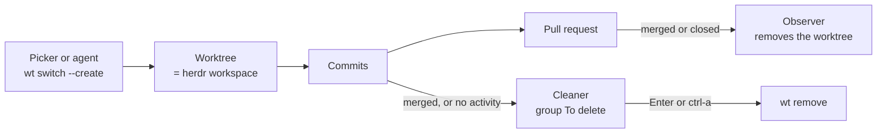
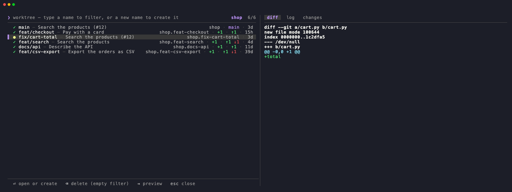
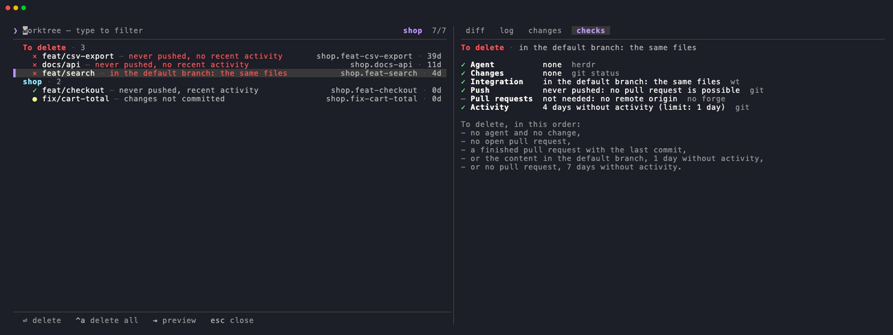
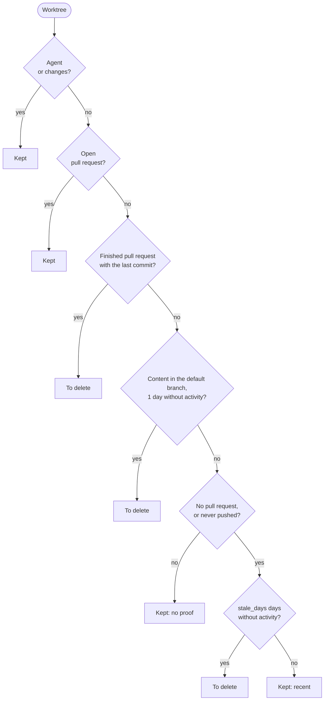
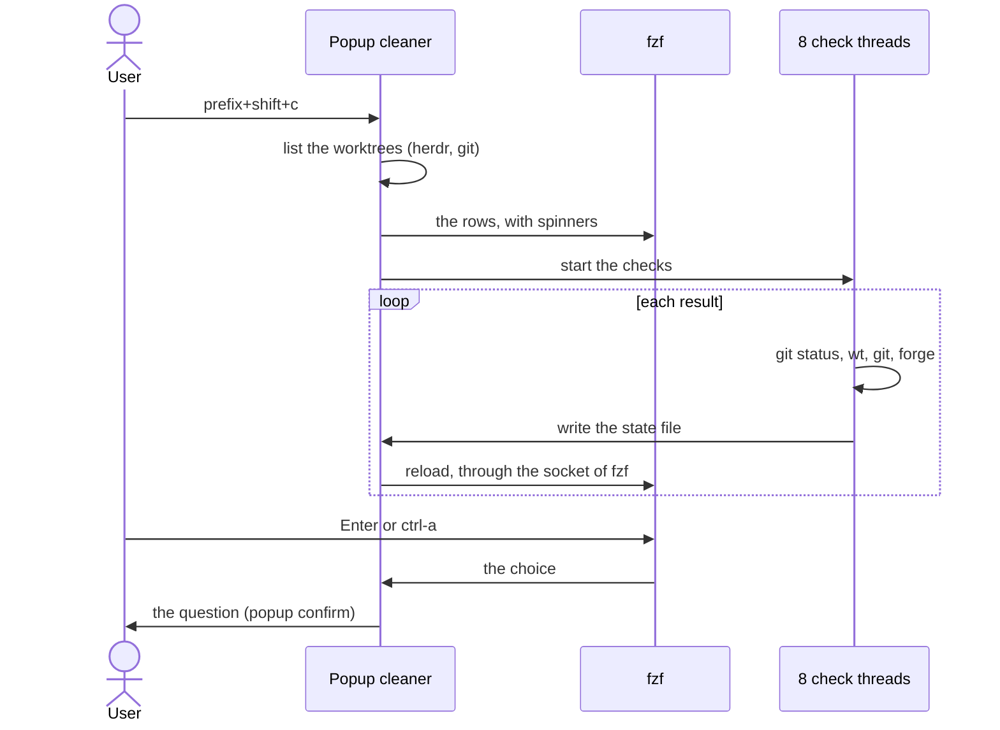

# herdr-worktrunk

A [herdr](https://herdr.dev) plugin that manages the git worktrees with [worktrunk](https://worktrunk.dev) (`wt`), and keeps one rule: **1 git worktree = 1 herdr workspace**.


## Features

- **[Picker](#the-picker)**: open, create or delete a worktree from one popup.
- **[Cleaner](#the-cleaner)**: see all the worktrees, and delete the leftovers. Each leftover has a proof: a finished pull request, a merge into the default branch, or a long time without activity.
- **[Observer](#the-observer)**: the pane of an agent follows its worktree, the workspace of a removed worktree closes, and the worktrees of the finished pull requests go away.
- **[Remove and merge](#actions)**: `wt remove` and `wt merge` for the worktree of the focused workspace, after a question.

worktrunk creates and removes each worktree, so its hooks run (`pre-start`, `post-start`, `pre-remove`...), and each worktree has the path of `wt`. The plugin replaces the worktree keys of herdr, which use git and `~/.herdr/worktrees`.



## The picker



`prefix+shift+g` opens the worktrees and the branches of `wt list` in fzf. Type to filter.

| Key | Result |
|-----|--------|
| `Enter` | Opens the worktree, or the worktree of the branch (wt creates it). A new name gives the first row `+ <name>`: `Enter` creates this worktree. |
| `⌫` | With an empty filter: asks to delete the worktree, then the picker comes back. With text in the filter: erases a character. |
| `Tab`, `shift-Tab` | Change the tab of the preview: `diff` (since the default branch), `log`, `changes` (not committed). |
| `shift-↑`, `shift-↓` | Scroll the preview. |
| `Esc` | Cancels. |

Each row gives the state (`✓` no change, `●` changes, `○` a branch without worktree), the branch and its last commit, then the folder, the lines and the commits since the default branch, the marker of wt and the age. If a row is too long, the folder goes away first.

The worktrunk picker (`wt switch`) has fixed keys (`alt-c`, `alt-x`), and a terminal program never sees `cmd`. Thus the plugin uses fzf, with keys that need no `alt` or `cmd`.

## The cleaner



`prefix+shift+c` lists **all the linked worktrees of the repositories of the herdr workspaces**, at once. Threads check each worktree in the background: its row shows a spinner until the check ends. The leftovers go to the group **To delete** at the top. The other worktrees stay in one group for each project, with the reason that keeps them.

| Key | Result |
|-----|--------|
| `↑` `↓` | Move to the next worktree, over the titles of the groups. |
| `Enter` | Asks to delete the worktree. The question gives its reason, for example an open pull request. |
| `ctrl-a` | Asks to delete the group To delete. |
| `Tab`, `shift-Tab` | Change the tab of the preview: `diff`, `log`, `changes`, and `checks`: the verdict and the result of each layer. |
| `Esc` | Quits. |

A deletion runs `wt remove`: wt keeps a branch that is not merged, and refuses changes that are not committed. The cleaner refuses a worktree where an agent works.

### The layers of proof

The cleaner checks each worktree layer by layer, from the cheapest to the most specific. The tab `checks` shows each layer with its source.

| Layer | Source | Fact |
|-------|--------|------|
| Agent | herdr | An agent works in the worktree. |
| Changes | `git status` | Changes that are not committed. |
| Integration | `wt list` | The content of the branch is in the default branch: merge, rebase or squash merge. Any forge. |
| Push | git | A branch that was never pushed has no pull request. A deleted remote branch is a hint only. |
| Pull requests | the forge | Open, merged or closed, and the proof that a finished pull request contains the last commit. |
| Activity | git | The days since the last commit, checkout or reset. A `git status` does not count. |

The verdict follows this order:



A new worktree has the commit of the default branch, so it is "integrated" at once: the day without activity keeps it. A forge that gives no answer (no login, no network, a limit of 15 s) never gives a leftover: the row says "not checked".

### The forges

| Forge | Integration, push | Pull requests |
|-------|-------------------|---------------|
| GitHub | yes | yes, with `gh` |
| GitLab | yes | planned (`glab`) |
| Gitea, Forgejo, Codeberg | yes | planned |
| Azure DevOps | yes | planned (`az`) |
| Other forges | yes | no |

The forge comes from the host of `origin`: a host with github, gitlab, gitea, forgejo or codeberg in its name, or Azure DevOps. For a self-hosted forge with another name, give its platform to worktrunk, in `~/.config/worktrunk/config.toml`:

```toml
[projects."git.company.example/*"]
forge.platform = "gitlab"
```

### How the checks run



- The list shows before any check. One call to wt (30 s at most) gives the integration of each worktree and the forge of a repository, with the forge config of worktrunk.
- `every(0.1)` of fzf turns the spinners without a process. The cursor stays on its worktree when the list reloads.
- After a question, the list comes back with the results of the last checks. A failed check runs again.
- With `fetch_before_check = true`, the cleaner fetches `origin` first. Off by default: a fetch can ask the ssh agent (for example 1Password) for a key.

From a shell, `clean` opens the same popup for one repository, and `list-stale` prints the old worktrees without pull request:

```sh
bin/herdr-worktrunk clean [<folder of a repository>]
bin/herdr-worktrunk list-stale <folder of the repository>
```

## The observer

The plugin starts an observer with herdr. Every 2 seconds, it reads the state of herdr:

1. **The pane follows its agent.** An agent that enters another checkout of the same repository moves to the workspace of this checkout, for example after `/worktrunk:wt-switch-create`. A new workspace with only one shell gets the pane of the agent in place of this shell.
2. **The workspace of a removed worktree closes**, if no agent works in it.
3. **The worktrees of the finished pull requests go away**, with `prune_merged = true`. Every 5 minutes, a thread checks the repositories of the herdr workspaces on GitHub.
4. **The old worktrees**, with `stale_days = <days>`: once a day, the thread opens the cleaner if a worktree is old and the thread did not ask about it in the last `stale_days` days.

<details>
<summary>The rules of <code>prune_merged</code></summary>

The thread removes the worktree of a branch only if the branch has no open pull request, if the default branch does not contain the local commit, and if a merged or closed pull request contains the local commit (its last commit, or a later commit after "Update branch" on GitHub). GitHub keeps each local commit: in the default branch after a merge, and in `refs/pull/<number>/head` after a close. After the removal of a closed pull request, the log gives the command that gets the branch back: `git fetch origin pull/<number>/head:<branch>`.

The agents of a finished worktree:

- If all its agents are `idle` or `done`, the thread closes their panes, then removes the worktree. The log gives the command that resumes each conversation, for example `claude --resume <session>`.
- If an agent is `working`, `blocked` or `unknown`, or if its workspace has the focus, the thread keeps the worktree, and tries again at the next pass.

The thread keeps a worktree with an open pull request, with its local commit in the default branch (`wt step prune` removes it), with changes that are not committed, or with a new commit after the check. It also keeps the main worktree, a detached worktree and a locked worktree, and ignores a pull request from a fork.

The thread removes the worktree and its branch with `wt remove --force-delete`, never with `--force`. It runs no `git fetch`: gh uses the API of GitHub. `list-merged` prints the worktrees that the thread removes, without a removal:

```sh
bin/herdr-worktrunk list-merged <folder of the repository>
```

</details>

<details>
<summary>The limits of the observer</summary>

- The observer watches only the agents. A shell that changes its folder does not move.
- A pane moves only if the observer sees the same difference in 2 snapshots in a row. A moved pane gets a new pane ID: address an agent with its herdr name.
- A workspace where an agent works stays open after the removal of its worktree. Close it with the herdr key `close_workspace`.
- `prune_merged` checks only a remote `origin` on `github.com`, and only when herdr runs. It stops a `gh` command after 1 minute, and a `git` command after 30 seconds.
- The observer never approves the hooks of a project (`--yes`). If a hook has no approval, run `wt config approvals add` in the repository.
- The observer writes each removal and each new error in `observer.log`, in the state folder of the plugin (by default `~/.local/state/herdr/plugins/herdr-worktrunk/`).

herdr runs `[[startup]]` when the server starts, and the event `pane.agent_detected` also starts the observer. A lock keeps one observer for each herdr server. herdr installs each version in a new folder: each `observe` command writes the path of its binary in `observer.binary`, and a running observer runs this binary within 2 seconds. The observer reads `config.toml` when it starts: after a change, run `pkill -f 'herdr-worktrunk observe --run'`.

</details>

## Actions

| Action | Result |
|--------|--------|
| `herdr-worktrunk.pick` | Opens [the picker](#the-picker). |
| `herdr-worktrunk.clean` | Opens [the cleaner](#the-cleaner). |
| `herdr-worktrunk.remove` | Deletes the worktree of the focused workspace with `wt remove`, after a question. Then the focus goes to the main checkout. |
| `herdr-worktrunk.merge` | Merges the worktree of the focused workspace into the default branch with `wt merge`, then deletes it, after a question. A large popup shows the output of wt. |

`remove` and `merge` refuse a workspace where an agent works. If an action cannot work, a small popup gives the reason. The question has 2 buttons: `[ Cancel ]` and `[ Delete ]` (or `[ Merge ]`). `←` `→` change the button, `Enter` presses it, `y` confirms, `Esc` cancels.

## Configuration

`config.toml` in the config folder of the plugin (`herdr plugin config-dir herdr-worktrunk`):

```toml
# Start the observer (default: true).
observe = true

# The observer removes the worktree of each merged or closed pull request (default: false).
# Needs gh.
prune_merged = false

# Once a day, open the cleaner if a worktree has no pull request and no change for this number
# of days (default: 0, off). Needs prune_merged = true. The cleaner uses 7 days if it is 0.
stale_days = 0

# The size of the picker, the cleaner and the merger: "default" (the size of herdr-bar,
# 74 % × 62 % of the window) or "big" (90 % × 80 %).
popup_size = "default"

# The cleaner fetches origin before its checks (default: false). The fetch can ask the ssh agent
# for a key.
fetch_before_check = false

# What an agent can do without a question at the end of a task in a worktree: "ask" or "auto".
# The plugin does not read this key: the agents read it (for example the skill worktrees of
# owpac/prompts).
agent_mode = "ask"

[repositories."~/.dotfiles"]
agent_mode = "auto"
```

The plugin reads only the top-level keys `observe`, `prune_merged`, `stale_days`, `popup_size` and `fetch_before_check`.

## Requirements

- herdr 0.9.0 or later, on macOS or Linux.
- worktrunk (`wt`) and git on the `PATH` of the herdr server.
- [fzf](https://github.com/junegunn/fzf) 0.73 or later (tested with 0.74): the popups use its events `every` and `load`, its server `--listen`, and its options `--footer`, `--ghost` and `--gutter`.
- For the pull requests on GitHub: [gh](https://cli.github.com) with a login (`gh auth login`).

## Installation

Install a release: give its tag, from the [releases](https://github.com/owpac/herdr-worktrunk/releases) page.

```sh
herdr plugin install owpac/herdr-worktrunk --ref <tag>
```

The install downloads the release binary for your machine, and checks it with the `SHA256SUMS` file of the release. Without a binary for your machine, the install builds it with cargo (Rust 1.89 or later). Without `--ref`, herdr installs the last commit of `main`, and always builds with cargo.

## Keybindings

Add `[[keys.command]]` entries to `~/.config/herdr/config.toml`, then run `herdr server reload-config`. To replace the worktree keys of herdr, unset them:

```toml
[keys]
new_worktree = ""
remove_worktree = ""

[[keys.command]]
key = "prefix+shift+g"
type = "plugin_action"
command = "herdr-worktrunk.pick"
description = "pick or create a worktree (wt)"

[[keys.command]]
key = "prefix+shift+x"
type = "plugin_action"
command = "herdr-worktrunk.remove"
description = "remove the worktree of the workspace (wt)"

[[keys.command]]
key = "prefix+shift+m"
type = "plugin_action"
command = "herdr-worktrunk.merge"
description = "merge the worktree of the workspace (wt)"

[[keys.command]]
key = "prefix+shift+c"
type = "plugin_action"
command = "herdr-worktrunk.clean"
description = "clean the worktrees (wt)"
```

## Development

```sh
git clone https://github.com/owpac/herdr-worktrunk
cd herdr-worktrunk
mise install                                         # Rust and shellcheck of mise.toml
HERDR_WORKTRUNK_BUILD=source sh scripts/install.sh   # build bin/herdr-worktrunk with cargo
herdr plugin link "$PWD"
bin/herdr-worktrunk observe                          # give the binary of the link to the observer
```

`herdr plugin link` does not run the build step: run `scripts/install.sh` again after each change. The checks of the CI:

```sh
cargo fmt --check
cargo clippy --locked --all-targets -- -D warnings
cargo test --locked
shellcheck scripts/*.sh
```

The images of this README come from `docs/make-images`: it makes a demo repository, then records the popups with [VHS](https://github.com/charmbracelet/vhs).

## Release

Each push on `main` makes a release. The version is `YYYY.M.N`: the month of the push in UTC, and the number of the release in this month (for example `2026.11.1`). On `main`, `herdr-plugin.toml` and `Cargo.toml` keep the version `0.0.0`. The workflow `release` builds the binaries for Linux and macOS (`x86_64` and `aarch64`), writes the version in a release commit, pushes the tag, and publishes the binaries with `SHA256SUMS`.

## Credits

- The behavior of the actions comes from [devashish2203/herdr-worktrunk](https://github.com/devashish2203/herdr-worktrunk) (MIT), a bash plugin for the same purpose. This plugin is a new implementation in Rust, with the observer.
- The build and release method comes from [herdr-bar](https://github.com/jeffarese/herdr-bar) (MIT).
- The design of the popups comes from [herdr-bar](https://github.com/jeffarese/herdr-bar) and [herdr-newtab-plus](https://github.com/jeffarese/herdr-newtab-plus).

## License

[MIT](LICENSE)
